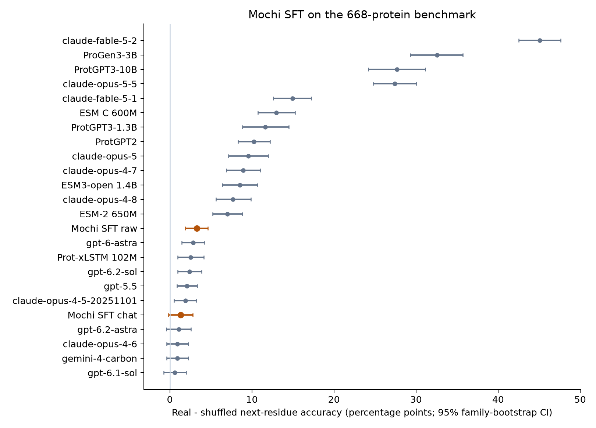

# Mochi SFT on the published protein-sequence probes

Mochi SFT step 400407 shows a small protein-continuation signal. On the main
668-protein benchmark, the real-minus-shuffled next-residue accuracy gap is
**+1.31 percentage points in chat** (95% family-bootstrap CI −0.15 to +2.78)
and **+3.28 points in raw FASTA continuation** (+1.89 to +4.65). This places
Mochi near the study's lower-scoring general language models, well below the
published Opus 5.5, Fable 5.2 and strongest protein-language-model results.
Neither Mochi format produces an exact 10-residue continuation on the main set.

| Model and format | Gap, percentage points | 95% CI | Source |
| --- | ---: | --- | --- |
| Claude Fable 5.2, chat | +45.09 | +42.51 to +47.63 | Published |
| ProGen3-3B, prefix | +32.54 | +29.31 to +35.69 | Published |
| ProtGPT3-10B, prefix | +27.66 | +24.19 to +31.14 | Published |
| Claude Opus 5.5, chat | +27.41 | +24.79 to +30.06 | Published |
| ESM C 600M, prefix | +12.96 | +10.72 to +15.24 | Published |
| Mochi SFT, raw FASTA | +3.28 | +1.89 to +4.65 | This run |
| GPT-6 Astra, chat | +2.85 | +1.45 to +4.24 | Published |
| Mochi SFT, chat | +1.31 | −0.15 to +2.78 | This run |
| Gemini 4 Carbon, chat | +0.92 | −0.37 to +2.25 | Published |

The metric averages each family's real-versus-shuffled accuracy difference;
it is not absolute sequence accuracy. Other models were not rerun. Their
scores come from the pinned upstream result tables. Prompting formats differ,
as labeled, and overlapping intervals do not establish a ranking.

Protein-continuation results are complete. Longer recall, DNA and contact-map
evaluations are still running.



## Question

Where does Mochi SFT step 400407 fall relative to the language models in
[Tu and Chen's study](https://xinmingtu.cn/blog/2026/claude-opus-5-5-protein-sequences/)?
The primary outcome is next-amino-acid accuracy on real proteins minus accuracy
on their shuffled controls, averaged across 167 protein families. Bootstrap
confidence intervals resample families, not individual prompts.

## Baseline and plan

Use [LLM-bioseq-probe at 1c0eb30](https://github.com/XinmingTu/LLM-bioseq-probe/tree/1c0eb30ec4aacc672386ec5e8a0d7e9f17e8e649)
for the exact released inputs, prompt constructors, shuffles, parsers and
published comparator outputs. Run instructed chat and untemplated FASTA
continuation on the main set. Supplement with the smaller-family set,
August-2026 proteins, pilot set, 158 published recall cases, DNA windows and
contact maps. The August set is not established to be after Mochi's cutoff.

The main set has four proteins from each of 167 Pfam families and five fixed
cuts per protein, inside its annotated domain. Each cut is queried on both the
real sequence and a composition-preserving shuffle of the full protein:
668 × 5 × 2 = 6680 requests per format. Chat asks for the next ten amino acids;
the headline accuracy scores only the first predicted residue. Exact-10 counts
require all ten residues to match and the target ten-residue sequence to be
absent from the prefix.

The primary rule excludes non-answers independently in each condition. A
non-answer is a refusal or a response from which the upstream parser extracts
no continuation. Compute the first-residue accuracy within each family and
condition, then average the real-minus-shuffled differences equally over
families. All 167 families remain in both main estimates. The sensitivity
analyses either count non-answers as incorrect or retain only cuts with valid
answers in both conditions.

Raw parsing takes up to ten residues from the beginning of the continuation,
stopping at a header, markup, a blank line or prose, following upstream
`parse_raw`. A nonempty answer shorter than ten residues still contributes to
first-residue accuracy but cannot count as an exact-10 continuation.

Mochi is the 535B-parameter model in Marin's
[post-training program](https://github.com/marin-community/marin/issues/11535);
SFT means supervised fine-tuning. This evaluation uses its step-400407 SFT
checkpoint, also evaluated in
[the prior weakness analysis](https://github.com/marin-community/marin/issues/11723).
The existing shared server reports `hero-sft-step400407`, max length 262144.
Its reported checkpoint is the export ending in
`hero-sft-fullab-step393k-v2/step-400407/2af3f828aa-cpu-a1`.
The endpoint is backed by an existing four-task serving job; this experiment
allocates no additional GPUs. Server identity is checked before and after
each suite, but this remains a shared serve rather than an immutable deployment.

Prompts use `marin-community/marin-tokenizer-tools` at
`3f6879acdaf3dae7874b2d48c7d11b9d8c6faf09`, rendered locally with
`enable_thinking=False`. Every request uses temperature 0,
`stop_token_ids=[128009,128001]`, and `skip_special_tokens=false`.
Token limits follow the authors' scripts: 4000 for chat protein/DNA,
24 for raw continuation, 8000 for recall, 32000 for contact maps.
The only text normalization maps Marin's thinking delimiters to the tags the
upstream parser recognizes; original response text is retained alongside it.

Transport failures get at most three attempts, each recorded. Non-answers are
never retried. Preserve all outputs, and distinguish errors and exclusions from
incorrect predictions. Report the main score under the published exclusion rule
and with non-answers counted as incorrect.

## Reproduction

Clone the upstream repository at the revision above. Download the pinned
tokenizer with `hf download`. Supply an endpoint URL ending in `/v1` in a local
credential file outside the repository. Set `PYTHONPATH` to the upstream `src`
directory, then run `run.py` with these arguments:

```bash
uv run --no-project --with google-genai --with anthropic --with openai \
  --with python-dotenv --with pandas --with numpy --with httpx \
  --with transformers --with jinja2 --with biopython --with gemmi --with scipy --with matplotlib \
  python logbooks/73-mochi-bioseq/run.py \
  --upstream /path/to/LLM-bioseq-probe --endpoint-file /private/endpoint.txt \
  --tokenizer /path/to/pinned-tokenizer --output /path/to/results \
  --suite confirm --workers 8 --run
```

Omit `--run` for input validation without inference. Other suite names are
`raw`, `small`, `d_set`, `pilot`, `recall`, `dna`, `contact`, and `contact_list`.
Keep each output directory for one source revision and request configuration.
The runner resumes existing question keys without overwriting records.

## Entries

### 2026-11-23 — Setup

The live model identity matches prior Mochi SFT evaluations in issue 11723.
Published comparator scores will be distinguished from newly measured Mochi
scores. No model result is available yet. The next step is a small prompt and
parser smoke check before the complete suite.

Publication note: the current account has read access but no push access to the
shared logbooks repository. Preserve the research branch in its GitHub fork and
link it from the coordinating issue.

### 2026-11-23 — Tokenization correction before scoring

The initial public proxy intermittently returned HTTP 503; a standard authenticated
Iris tunnel reaches the same serving endpoint. All 20 smoke requests then completed,
six reaching the 4000-token limit with repeated amino-acid text.

A token-count audit found that the rendered prompt's 179 tokens became 180 at
the completion API: the tokenizer prepended a second BOS token. Stop the
incomplete `confirm` and `small` runs from runner revision `43f074efe4`, retain
their outputs as invalidated setup evidence, and exclude them from all scores.
Set `add_special_tokens=false` for rendered chat prompts and verify the API
prompt count before restarting into a new output directory. Raw FASTA
completion uses the API's single automatic BOS and is unaffected; its original
run can be retained.

The analysis reproduces the published Opus 5.5 real accuracy, shuffled accuracy,
and family-averaged gap exactly (34.8607367%, 7.4617920%, +27.4062402 points).
Bootstrap bounds vary slightly with random-number ordering; the estimator and
10,000-family-resample design match the source. Permutation p-values use the
finite-simulation correction `(hits + 1) / (10000 + 1)`.

### 2026-11-23 — Protein suites complete

The corrected chat prompts match the server's token IDs exactly on three
audited examples (179, 85 and 83 tokens). All five protein suites completed
without an exhausted transport retry. Chat, small-family, newer-protein and
pilot requests used 32 concurrent workers; raw continuation used eight.

Pooled main chat accuracy is 10.06% on real prefixes and 8.78% on shuffled
prefixes among parsed answers. Their difference differs slightly from the
headline gap because the latter weights families equally. There are 185
excluded non-answers: 10 real and 175
shuffled. Counting them as incorrect increases the family-averaged gap to
+1.71 points (95% CI +0.30 to +3.14); retaining only cuts with both answers
valid gives +1.31 (−0.17 to +2.83). The main chat run has 286 token-limited
responses out of 6680. Raw continuation has 42 non-answers; counting them as
incorrect changes its gap to +3.26 (+1.89 to +4.61). All raw responses reach
the prescribed 24-token cap, which is expected for untemplated continuation.

Neither format passes the authors' H1 criterion: one-sided family sign-flip
`p < 0.001` and the 95% interval's lower bound above 10 percentage points.
Neither passes H2 (positive Spearman correlation between the gap and log10
Pfam family size on the main 167 families, one-sided `p < 0.01`) or H3 (at least 10 exact
continuations, over 100 times the independent-position expectation, with none
on shuffled controls). These are the published decision rules applied to Mochi,
not newly preregistered hypotheses. Family size is the upstream table's
`family_proteins` count of members in the biological family, not the four
proteins sampled into the benchmark.

| Supplementary chat set | Questions | Gap, percentage points | 95% CI |
| --- | ---: | ---: | --- |
| Smaller families | 3600 | +0.57 | −1.46 to +2.61 |
| August-2026 proteins | 560 | −7.22 | −13.57 to −1.12 |
| Main proteins restricted to the same 31 families | 1240 | +2.02 | −1.07 to +5.08 |
| Well-studied pilot families | 1140 | +8.59 | +4.06 to +13.19 |
| Obscure pilot families | 1080 | −1.59 | −4.38 to +1.08 |

Across the main and smaller-family sets (257 families), the correlation of
the accuracy gap with log family size is Spearman ρ = 0.050, two-sided
`p = 0.421`. The pilot's stronger performance on well-studied families is
descriptive: these are different families, so this comparison does not isolate
the causal effect of literature exposure. The newer-protein set is small
(56 proteins, 31 families), and Mochi's training cutoff has not been verified.
These probes do not establish which sequences were in its training data.

The analysis reproduces the upstream Opus 5.5 gap, all 12 exact continuations,
and the independent-position expectation of 0.5706195603 exactly. The raw
runner is preserved at `43f074efe4`; the corrected chat runner is at
`26493a821c`. Contact-pair-list support is added at `80ebf04db2` without changing
protein or DNA requests. Per-suite manifests identify the executed runner by
SHA-256, tokenizer revision, input hashes and package versions.
